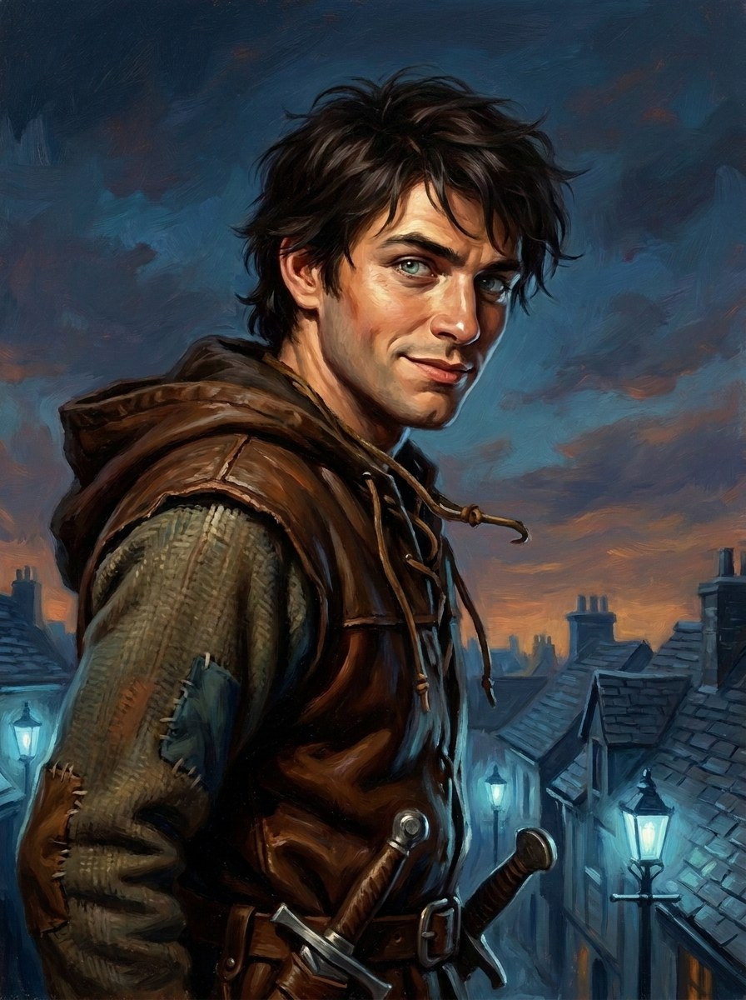
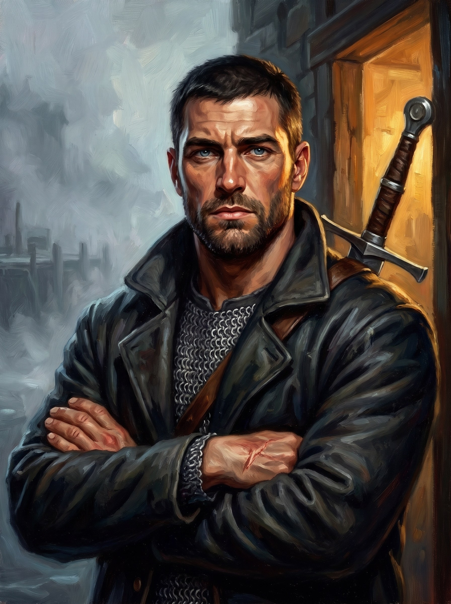
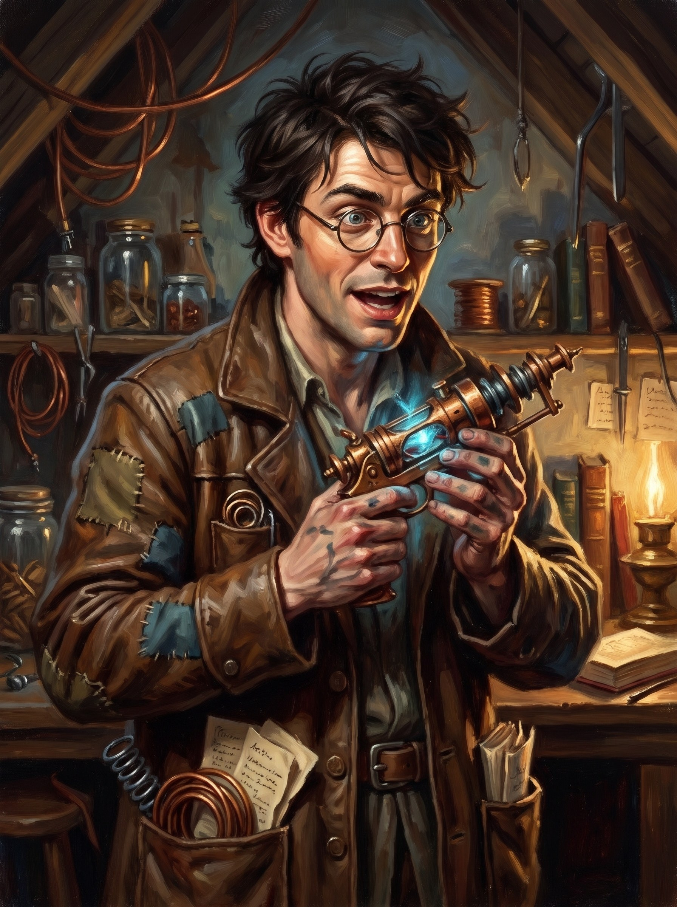
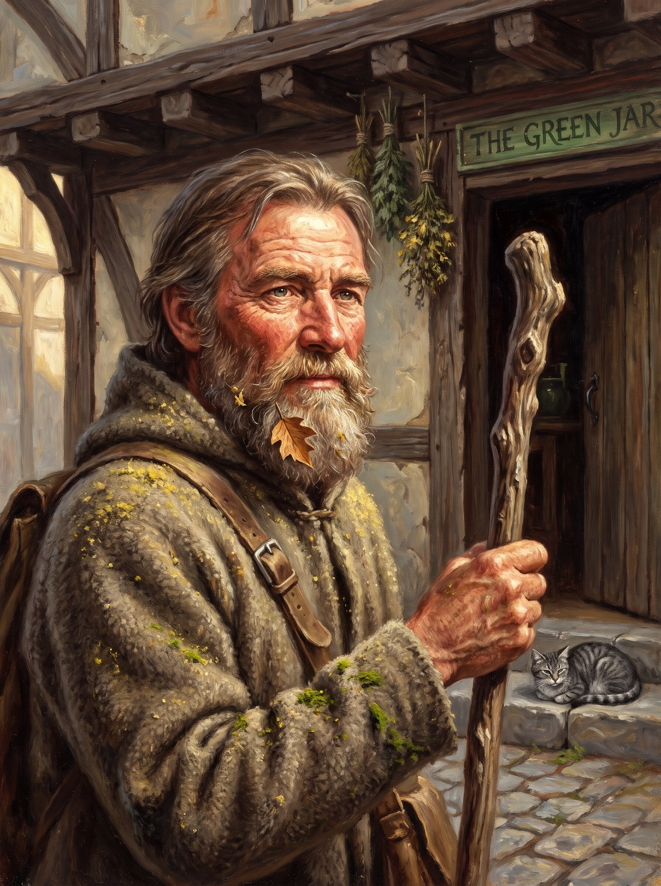

# Hearth & Hall · Player Packet

> **Read this before session one.** Everything here is something Ash knows, or something any Emberford local would know. Nothing in here is secret, and nothing in here is a trick. Rumors are marked as rumors.
>
> Your full character sheets are in `party-sheets.md`. House rules are in `rules-and-house-rules.md`. What Ash knows and who he trusts is tracked in `party-knowledge.md`.

---

## Contents

1. Ash
2. Bart
3. Your brothers, and Moss
4. Willow Lane: the people Ash knows
5. Other people Ash knows around the city
6. Emberford, the home city
7. Shops, the Enchanters' Row and where to spend money
8. Things to do in Emberford
9. Festivals, customs and the calendar
10. The wider world (common knowledge)
11. Rumors going around this spring
12. Maps and portraits

---

## 1. Ash

**Asheron Fenwick.** Everyone calls him Ash. Only his brothers use "Asheron," and he hates it. Twenty years old. Human. The youngest of three brothers, about twelve years younger than the other two.

### Where he came from (as far as Ash knows)

- Ash was born on **Midsummer's Eve**, the night of the Turn of Light festival. Every year the whole city floats little lamps down the river on his birthday. He's never minded sharing.
- His father, **Tom Fenwick**, was a bargeman and ford-pilot on the Fordwater. His mother, **Elinor Fenwick**, was a seamstress.
- When Ash was about two, the family's small river barge **caught fire at night on the Fordwater**. Both parents died. Ash was **found alive on the riverbank**. People in the Fringe still call it "the Fenwick barge fire."
- Ash doesn't remember his parents at all. He knows them from Gideon's stories, Zeke's stories and the neighbors' stories, and from the way old people on the Lane sometimes look at him.
- **Gideon was fourteen** when it happened. He went to work that same year and has kept the family house ever since. Zeke was thirteen. The two of them raised Ash between them, with a lot of help from the Lane.

### How he gets by

Ash has never held one job for long. He's tried his luck at almost everything:

- **Courier runs:** messages, parcels, "don't-open-it" packages. 2–20 gp a run. A rival outfit, **Swift and Sons**, keeps undercutting his prices.
- **Retrieval:** finding lost rings, stolen dogs, a pawned heirloom someone's grandmother wants back. 10–100 gp.
- **Minor bounties** off the Watch board: skipped debtors, pickpocket gangs. 5–50 gp.
- **Contests he has a tiny chance of winning.** Some he's won. Some he's lost badly. He enters anyway.
- **Street hustling:** cards, dice and the shell game on Market Steps, for a little coin.
- **Stealing.** But never in his own neighborhood. Never from the Fringe.

### The doorstep

For about two years, Ash has been leaving stolen food and coin on the doorstep of **Bess Carter**, a widowed washerwoman with two kids. She has no idea it's him. On Willow Lane there's a custom: if someone leaves something on your step, you don't ask. Ash does the same, quietly, for other neighbors who are barely getting by. He takes from Crownhill carts and rich men's purses. He gives to the Lane.

### Personality hooks

- **The roof hatch is his front door.** He's on the rooftops more than the street.
- **He hates his full name.** Use it on him and watch him wince.
- **A code nobody wrote down.** Don't steal from your own. Don't hurt people who can't hurt you back. Don't snitch.
- **Lucky, and he knows it.** He'll push his luck because it usually holds. (He took the Lucky feat for a reason.)
- **The little brother.** He's twenty, but everyone on the Lane still talks to him like he's twelve, and his brothers are the worst about it.
- **Owes Simon Shaw** a whole page of the chandlery slate, and has never once been asked to pay it.

### His keepsake

Ash wears a **dented pewter half-locket** on a leather cord under his shirt. On the front is a worn crest: a river ford with antlers above it. Inside, behind cracked glass, is a curl of baby hair and a scratched letter "A." The hinge is broken off on one side.

Gideon gave it to him when he was ten and said, *"That was Mum's. That's your hair in it. The other half was lost in the fire."*

Ash has pawned everything he owns at least once. He has never pawned this. He's never quite been able to say why.

### What he's carrying

Full numbers are on his sheet. In short:

- **Weapons and armor:** leather armor, shortsword, 4 daggers, shortbow with a quiver of 20 arrows
- **Thief's kit:** thieves' tools, grappling hook, 10 pitons, chalk, a steel mirror, a bag of caltrops, manacles (for bounties)
- **Burglar's pack:** backpack, rope, crowbar, hooded lantern, oil, candles, ball bearings, a bell, tinderbox, rations, waterskin
- **Clothes:** traveler's clothes, one set of fine clothes (for looking like he belongs somewhere he doesn't), a bedroll, two pouches
- **Games:** a deck of cards (he's good), a set of dice (he's lucky), and three cups and a ball for the shell game
- **The half-locket**
- **10 gp**

---

## 2. Bart

**Bartholomew.** Ash calls him **Bart**, which Bart hates about as much as Ash hates "Asheron." That's the point.

- **A tiny northern saw-whet owl**, most days: about 3–4 ounces, fist-sized, huge yellow eyes, no ear tufts. He fits in a coat pocket and resents it. (Rules: the standard Owl familiar stat block; the size is flavor.) Ash summoned him with the Find Familiar spell a while ago (Zeke helped). He's a spirit, not a real bird.
- **He talks only in Ash's head.** Telepathy, within 100 feet. Nobody else hears a word. If Ash laughs at nothing in the middle of a serious conversation, that's Bart.
- **He is snarky.** He makes fun of Gideon and Zeke constantly. He's lippy with Ash, too. It's the kind of joke that's only funny if you're not the one it's about. Ash can always pass it along: *"He says you're an idiot."*
- **He helps in a fight** by swooping in to distract an enemy (the Help action), which gives Ash advantage on his next attack. Owls don't provoke opportunity attacks when they fly away.
- **He has 1 hit point.** Smart enemies who notice what he's doing will swat him. If he's "killed," he just pops back to his pocket dimension, and Ash can call him back later with the spell.
- **The house rule:** once a day, outside of combat, Bart can blink into his pocket dimension and come back as a different small creature (a spider, a rat, a cat and so on) for up to an hour. **Bart picks the shape.** Ash tells him what needs doing, and Bart decides the best way to do it. Then he blinks back and he's an owl again.

---

## 3. Your Brothers, and Moss

### Gideon Fenwick

*(aka Gid. Spellings that might come through: Gidion.)*

- **The oldest brother, 32.** A paladin, though he hasn't sworn a holy oath yet.
- **The respectable Fenwick.** He works the door as a bouncer at the **Drowned Lantern** on the Wharves, takes private guard jobs in Crownhill, and works odd security jobs with Sergeant Ostley's off-duty watchmen. His pay keeps the house tax paid. He has kept up the tax on the family house for eighteen years.
- **Dutiful, rule-minded, and always trying to rein Ash in.** He knows what Ash does. He disapproves of how Ash does it, not of who it's for.
- **Calls everyone by their full names.** "Asheron." "Ezekiel." "Margery." Even the Provost.
- **Short, plain sentences.** Folds his arms before he says anything hard. Has an old burn scar on his left palm.
- **His room** is neat. His sword hangs on pegs. His bed corners could cut bread.
- **What he sounds like:** *"Asheron. Down. Off the roof. Now. And bring whatever's in the sack."*

### Zeke Fenwick

*(Ezekiel. Only Gideon calls him that. Spellings that might come through: Zeek, Ezekial.)*

- **The middle brother, 31.** One year younger than Gideon. A wizard.
- **Geeky, bookish, a tinkerer.** His attic workshop at the top of the house is full of half-built gadgets, coils, glass and springs. Some of them work.
- **A student at the Lyceum of the Lamp** whenever the family can afford it, which is often not. Right now he's between terms. A scholarship from the **Enchanters' Guild** has paid his tuition twice, and he's hoping it comes through again. He thinks the world of **Master Hollis Grane**, the Guild's head, who's been kind to him.
- **Loves the Enchanters' Row** more than anywhere in the city.
- **Covers for Ash half the time and lectures him the other half.** Calls him "Ash," never "Asheron."
- **Talks fast, in tangents, with his hands.** Pushes his spectacles up with one knuckle. Says "technically" a lot.
- **What he sounds like:** *"Technically it's not stealing if the coil was already humming when I found it. Hold this. Don't touch the blue end."*

### Moss

*(Spellings that might come through: Mos, Old Moss.)*

- **The herbalist halfway up Willow Lane.** He owns **the Green Jar**, a little herb and remedy shop: teas, poultices, salves, bunches of drying herbs from every beam, jars to the ceiling, and a grey cat on the counter. He lives above it.
- **His grumpy assistant, Aggie Thorne, mostly runs it.** Moss is out the **West Gate** every morning "gathering" in the Fordwood, and back by dusk, same as always. Because he walks the Lane at both ends of the day, he sees everything the brothers get up to.
- **He's been on the Lane since before Ash can remember.** He eats Restday supper with the brothers most weeks. He's the closest thing the boys have to an uncle.
- **A druid.** He knows the green magic: healing, growing things, talking a frightened animal down. His remedies work better than they should.
- **Kind, dry, unhurried.** A soft, slow countryman's voice. Calls Ash **"lad."** Hums under his breath while he works. When there's something he won't talk about, he says, *"I'd rather not say."*

### At home

- The brothers own a **narrow, tall, slightly leaning three-story wooden house** at the very bottom of Willow Lane, next to the water. It was their parents' house. Creaky stairs. Kitchen and the long supper table downstairs. Gideon's room and Ash's room on the middle floor. Zeke's attic workshop at the top, and the **roof hatch** Ash uses more than the front door.
- **Money is always short.**
- **Restday supper is sacred.** All three brothers eat together, usually with Moss, and usually with a neighbor dropping in with a pie, a complaint or a bit of news.

---

## 4. Willow Lane: The People Ash Knows

Willow Lane is a crooked lane of about twenty wooden houses running down from the West Gate road to a slow side-channel of the river called **the Bend**. Willows, chickens, washing lines strung between the houses like party flags, a shared well, and children everywhere. Poor, tight-knit and proud.

**From the top of the Lane to the bottom:**

### Sergeant Bill Ostley · the Fringe watch-house, West Gate road
*(aka Billy, Sarge. Spellings: Ostly, Osley.)*
- Sergeant at the little Fringe watch-house just outside the old city wall. In his fifties, paunchy, tired.
- **He's known Ash since Ash was a brat stealing apples.** Some of his off-duty watchmen work security jobs with Gideon.
- Sighs before he speaks. Looks at the sky when Ash is doing something illegal.
- *"I didn't see that. I'm going to keep not seeing it for about ten more seconds."*

### Hugh Dale · the Fringe watch-house
*(Spellings: Hew, Huey Dale.)*
- A young Fringe watchman. Very by-the-book. Does the paperwork Ostley won't. Looks at Ash with an expression of deep suffering.

### Peg Mallory · the Willow
*(aka Peggy, "Mother Willow." Spellings: Peg Malory.)*
- Landlady of **the Willow** (some call it the Crooked Willow), the little hunchbacked tavern at the top of the Lane. It's the neighborhood's living room.
- Big laugh, a laugh like a dropped tray. Keeps the peace by banging a cast-iron pan on the bar.
- *"Fenwicks! Sit before you fall. Gideon, you're paying. Ash, you're washing."*

### Simon Shaw · Shaw's Chandlery
*(aka Si. Spellings: Simon Shore.)*
- The Lane's chandler: candles, lamp oil, rope, nails, string. Thin, careful, kind. Does sums out loud and peers over tiny spectacles.
- Ash has a whole page in his ledger ("A. Fenwick") that Simon has never once collected on.
- *"Put it on the slate, Ash. No, I don't want to hear it. Slate."*

### Netta Lowe · the Lane Well
*(aka Nettie. Spellings: Neta, Netta Low.)*
- Fishwife who sells eels and river fish from a barrow beside the Lane Well. **Knows everything and tells most of it.** Talks fast, always mid-story, points with a fish.
- If there's a rumor in the Fringe, Netta had it first.
- *"Did you hear? Did you?"*

### Aggie Thorne · the Green Jar
*(aka Aggy, Agatha. Not to be confused with Widow Agnes Brack of the Brewers' Guild.)*
- **Moss's grumpy assistant**, in her fifties, with forearms like a bargeman's. Runs the Green Jar while Moss is out, which is always.
- Rude to customers. Tender with sick children. Calls Moss "the old stump."
- Gravel voice, sarcasm, never says please. Points with whatever she's holding.
- *"Wipe your feet. No, the other feet. He's out. He's always out. Buy something or stop breathing on the jars."*

### Bess Carter, Pip and Nell · the Carter house
*(Bess: aka Bessie, "Widow Carter." Spellings: Bes, Beth Carter.)*
- **Bess** is a widowed washerwoman who takes in washing from Crownhill. Always tired, always proud. Kind under the edges. Wary of Ash being a bad influence on her son.
- **Pip** (9) thinks Ash is the greatest thief who ever lived and will follow him anywhere if nobody stops him.
- **Nell** (5) is shy and always cold. Most days she's wrapped in a man's coat that comes down past her feet.
- This is the doorstep Ash has been feeding for two years. **Bess doesn't know it's him.**
- *"Pip, get out from under the Fenwick boy's feet. Ash, love, you look starved. Sit. There's soup. Don't argue."*

### Dora and Walt Finch · the Finch house
*(Dora: aka Dorrie, "Mother Finch." Spellings: Dora Fink. Walt: aka Walter. Spellings: Walt Fink.)*
- **The old couple** on the Lane. Barely getting by.
- **Dora** is a retired midwife in her mid-seventies who delivered half the Fringe. Soft, rambling, starts her sentences twice, pats your hand. She adores Ash.
- **Walt** is a retired rope-maker in his late seventies. Stubborn as a knot, gruff, funny. **He taught Ash to tie knots** down at the Rope-walk. Their roof leaks, and he keeps trying to climb ladders he shouldn't.
- *Walt:* *"Boy. You've good hands and no patience. Hold this ladder or get up it, one or the other."*

### Rook · two lanes over
*(Real name Danny Pratt. Spellings: Rooke, Ruk, Dan Pratt.)*
- **Ash's lifelong rival.** 21. Grew up two lanes past Tanner's Row, where his mother Martha still lives.
- **Leader of the Magpies**, a crew of young street thieves. Quick hands, quicker mouth. Flips a coin across his knuckles.
- **The difference between them:** Rook steals from anyone, including the Fringe, and keeps it all for himself. Ash thinks that makes him a rat. Rook thinks Ash is a fool.
- Calls Ash "Fenwick."
- *"Everyone's bought, Fenwick. You just haven't had the right offer."*

### Old Bram · the Bend
*(Spellings: Bramm.)*
- The old ferryman who runs a ferry-barge from the Bend. A real local hero: in the **Great Flood of 1079** he pulled forty people out of the river.

### Places on the Lane
- **The Lane Well:** the shared well with a little wooden roof. Gossip lives here.
- **The Bend:** the slow, green side-channel at the bottom of the Lane. Fishing, swimming, eel traps, and a rotting old barge the kids play pirates on.
- **The Rope-walk:** a long, dim shed east along the Bend where rope gets made. Ash's old hiding place.
- **Tanner's Row:** stinking tannery yards east of the Lane. Work for anyone strong.
- **The West Gate:** the old city gate at the top of the Lane, and the road through it into the city.
- **The Fordwood:** past the orchards on the Westwood Road. Old woods. Moss goes "gathering" there every morning. Most people avoid it after dark.

---

## 5. Other People Ash Knows Around the City

- **Jory Tolliver** (Jorrie), **Odd Lot**, Market Steps. A sly half-elf pawnbroker with a gap-toothed grin. Doesn't ask where things came from. **Ash's main fence.**
- **Mother Brine** (Bethany Rourke), **Mother Brine's**, the Wharves. A retired sailor with a wooden leg and a foghorn voice who sells potions and remedies. Tough love. Teases everyone.
- **Ma Garrow** (Garo), **the Bucket**, the Wharves. A big, very quiet woman who runs the underground fight ring. Everyone avoids her. She cracks walnuts one-handed, and for some reason she seems to like Ash. Her ring will put him on a fight card any Tenth-day he likes.
- **Big Tam Hollin**, the Smiths' Guildmaster in the Commons. Honest and loud. Gideon's sometime employer.
- **Captain Roderick Hale** (Rod), Captain of the Ford Watch. Practical and tired. Takes small bribes for small things, but won't sell out a murder. Ash knows him mostly by reputation.
- **Hester Grane**, who runs **Lamp House**, the city orphanage on Temple Isle. Brusque, tireless, and kind with her hands more than her words. A local hero who has fed half the Fringe. She's known the Fenwicks since the fire and still sends bread.

---

## 6. Emberford, the Home City

*(aka the Ford. Spellings: Ember Ford, Emberforde.)*

Emberford is the great river city of the Midriver: about 65,000 people, built on islands and hills where the **Tamber River** splits around an old shallow ford. Warm stone, slate roofs, bridges everywhere.

It's **the city of lamps.** Thousands of **glimmer lamps** hang on every corner, every barge and every tavern sign: little glass globes holding a chip of pale blue crystal that glows when you tap it and stays lit for a month. The city never goes fully dark.

**Magic is normal here.** Poor kitchens have heat-stones. Dockhands have warm-coat charms sewn into their collars. Taverns have self-stirring pots. A flying message-moth carries a note across town for 1 copper. Doorbells sing.

**It smells like** river mud, bread, tannery lye in the Fringe, hot metal on the Enchanters' Row and frying fish at the Wharves.

**The city motto,** carved over the Guildhall: *"Every hand a light."*

### Who runs it: the Guild Concord

- Emberford is a **guild republic.** No lord. No king's governor. The crown in Highmarch gets its taxes and leaves the city alone.
- **Nine Great Guilds** each send their Guildmaster to **the Concord**, which meets in the Guildhall.
- The Concord elects a **Provost** for five years, to be chief official, top judge and the city's voice to the crown.
- **Current Provost: Margery Teague** (Margie). She's the Bargemen's Guildmaster. Gruff, honest, overworked, and she distrusts "lamp people." She's up for **re-election this Harvest.**
- If you're not in a guild, you don't get much say. That's most of the Fringe.

| Guild | Guildmaster | What a local knows |
|---|---|---|
| Bargemen and Porters | Margery Teague (also Provost) | Biggest guild, the city's muscle |
| Merchants and Factors | Osric Vane | The money men |
| **Enchanters** | **Master Hollis Grane** | The richest guild. Controls glimmer and licenses every charm sold on the Row. |
| Lamplighters | Dorcas Fell | Keep the city's lamps lit and recharged |
| Smiths and Wrights | Big Tam Hollin | Honest and loud |
| Brewers and Vintners | Widow Agnes Brack | Runs half the taverns; pays for the festivals |
| Weavers and Dyers | Lionel Hartley | Fashion, Crownhill money |
| Masons | Garrick Stone | Bridges and walls |
| Physicians and Apothecaries | Doctor Prudence Ames | Licenses healers. Not a fan of the Green Jar. |

**What everyone says about Master Hollis Grane:** kind, grey-bearded and plain-spoken. He pays for lamps in poor streets, for scholarships at the Lyceum and for Lamp House, his sister Hester's orphanage. Most of the city loves him.

### The law: the Ford Watch

- About **300 watchmen** for the whole city. One watch-house per district, and a jail on Temple Isle that everyone calls **the Cage.**
- **Captain Roderick Hale** runs it.
- The Watch patrols Crownhill, the Islands and the markets. **They barely touch the Fringe and the Wharves.** Out there, people sort things out themselves.
- **How the law really works:** guilds police their own, Crownhill hires private guards (Gideon's trade), the Wharves answer to the dockmasters, and the Fringe takes care of itself.
- **Punishments:** fines, the stocks on Market Steps, a night in the Cage, or labor on the river dredges. Theft gets a fine or a flogging. **Stealing from a guild gets the guild's own justice, which is worse.** Hanging is only for murder and treason.
- **Bounty boards** hang outside each watch-house: small bounties, 5–50 gp.

### The districts

**Crownhill** (the rich district). The tall hill on the east bank. White stone townhouses, walled gardens, private glimmer fountains, guards at every gate. The Provost's residence, Brightwell & Daughters, the Weavers' showrooms, the Assembly Rooms (balls and auctions). *Everything there is worth stealing,* and everything has private guards, ward-chimes and dogs. Nobles here hire people like the Fenwicks off the books: retrievals, quiet escorts, finding runaway heirs.

**The Islands.** Two islands in the Fordwater, joined to the banks by **the Seven Bridges**.
- **Guildhall Isle:** the great domed Guildhall, the Exchange, the Hall of Records, and the 60-foot Great Lamp pole.
- **Temple Isle:** the Temple of the Bright Lady, the Cage, Ford Watch headquarters, and **Lamp House** orphanage.

**The Commons.** The big working district on the west bank, where most of the city lives. Smiths, coopers, bakers, tenements, crowded taverns. Loud and busy. The **Hammer and Hops** (the smiths' tavern) and Tam Hollin's forge are here.

**Market Steps.** A long stair-street of terraces running down from the Commons to the river. Every terrace is a market: fish, cloth, spice, junk, pets, books. **Odd Lot**, the **Bone Table** dice game, the **stocks**, street performers and the knife-throwing wall. **News travels here first.**

**The Wharves.** The long riverfront below Market Steps. Barges, warehouses, sailors, porters, gulls. **Mother Brine's**, the **Wharfmaster's Office** (job board), **the Drowned Lantern** (Gideon's door), Warehouse Row, and somewhere underneath it all, **the Bucket**. Rough, but friendly to anyone who works.

**Glimmerway** (the magic district). Between the Commons and Old Ford. Narrow lanes under glass awnings, always humming. The **Enchanters' Row**, **the Lyceum of the Lamp** (Zeke's school, with red-brick quads, a crooked tower and a library with a moving staircase), **the Patient Owl** and **the Clockwise**. **The Iron Kettle** is just on the Commons edge.

**Old Ford.** The oldest walled district, just inside the West Gate, where the city began. Crooked half-timbered houses, a mossy old chapel, and **the Ford Stone**, a worn standing stone in the square where couples swear their promises and children make wishes. Quiet, genteel-poor, full of old people.

**The Fringe** (home). Outside the old wall, beyond the West Gate, where the city spills out into garden plots, tanneries, rope-walks, small wooden houses and willow-lined lanes along the Bend. Not in any guild district, so nobody looks after it but the people who live there. **Willow Lane** is here.

### Local heroes

- **Provost Margery Teague**, who fought river pirates when she was young.
- **Hester Grane**, who runs Lamp House and has fed half the Fringe.
- **Old Bram** the ferryman, who pulled forty people from the river in the Great Flood of 1079.

### People everyone avoids

- **Ma Garrow** at the Bucket.
- **The Tolley brothers**, debt collectors for the Merchants' Guild.
- **The lamp-wardens**: masked guards in silvered half-helms who guard Enchanters' Guild shipments. Nobody talks to them, and they don't talk back.
- **The Fordwood after dark.**

### What any local knows

- **Glimmer** comes from glimmerstone, a crystal the Enchanters' Guild mines from "deep springs" somewhere outside the city and refines in Glimmerway. Only the Guild is allowed to mine or refine it. **Prices keep going up.** The Guild says the springs are running thin.
- **The Bright Lady** is the city's goddess. Her temple is on Temple Isle. Most people tap a lamp for her blessing.
- **A new circle called "the Quiet"** meets in Old Ford for people who've lost someone. People say it really helps.
- **Nobody in Eyrland has ever seen a talking beast**, except in stories.
- **Dwarves won't touch glimmer. Elves won't sell it. Gnomes complain it's "imprecise."**

---

## 7. Shops, the Enchanters' Row and Where to Spend Money

### Magic shops worth knowing

| Shop | Where | Keeper | What it's like |
|---|---|---|---|
| **The Patient Owl** | Glimmerway | Master Ambrose Webb, an ancient, glacially slow scholar | Dusty, silent, smells of candle wax. Scrolls, spellbooks, wands, arcane focuses. Won't sell to the rude or the rushed. Rewards patience. Zeke's favorite. |
| **Brightwell & Daughters** | Crownhill | Madame Ottoline Brightwell and her three polished daughters | Glossy, glittering, expensive glimmer fashion and jewelry. Snobbish to Fringe folk until you have money. |
| **Odd Lot** | Market Steps | Jory Tolliver | Junk to the rafters. Secondhand magic, cheap, and half of it has a quirk. Haggling is the sport. Doesn't ask questions. |
| **Mother Brine's** | The Wharves | Mother Brine | Potions, healing draughts, antitoxins, sailor charms. The sailor's choice. |
| **The Iron Kettle** | Commons edge | Hakon Stonebrow, a dwarf smith | Hot, loud, honest. Real dwarven weapons and armor, no glimmer at all. Pricey and worth it. Gideon's favorite. |
| **The Clockwise** | Glimmerway | Nim Gearwright, a young gnome tinker | Bubbly and frantic. Gadgets, clockwork helpers, tools and "experimental" items. The demos sometimes explode. |
| **The Green Jar** | Willow Lane | Moss (and Aggie) | Not a magic shop. Herbs, teas, poultices, a healer's kit or two. The remedies just work better than they should. |

### The Enchanters' Row

A narrow, glass-roofed lane in Glimmerway, about two hundred feet long, lined with tiny workshops. Glimmer sparks drift in the air. Chimes tinkle. It smells of hot glass and lavender oil.

**The Row will make you almost any small charm you can imagine, for a price.** That's what it's famous for, and **small enchanted trinkets are the customary gift on Lantern Night.**

**How a commission works:**
1. Pick a workshop and describe what you want.
2. The enchanter quotes a price and a time (usually 3 days to 3 weeks).
3. Pay half up front. Pay the rest when you pick it up.
4. Engraving or a personal message is free.
5. Every legal Row item carries a tiny lamp-shaped Guild license stamp. Unlicensed charms are cheaper, and illegal.

**Rough prices:** a small everyday charm (a Common item) is about **100 gp**. Something stronger (Uncommon) is about **400 gp**, and some workshops need you to bring special materials.

**The workshops, as a local knows them:**

| Workshop | Maker | Specialty | The kind of thing they make |
|---|---|---|---|
| **Hearthglow** | Old Wat Ember | Warmth and comfort | A ring of warmth, a mug that keeps drinks hot, a blanket that's always warm, boots that never get cold |
| **The Dry Cloak** | Sister Rosalind Fairweather | Weather and clothing | A cloak that's always dry, a hat that shades in sun and sheds rain, a wind-proof scarf |
| **Bottomless Barrel** | Jem Tapper | Food and drink | A never-empty flask of good booze, a self-cooling bottle, bread that stays fresh |
| **Keepsake & Locket** | Widow Elspeth Marsh | Memory and sentiment | A locket with a moving picture, a music box that plays a voice, a letter that reads itself aloud |
| **Lightfinger** | Corwin Lockley | "Stage magician" items (wink) | Gloves that never leave prints, a coin that lands the way you want once a day, a pouch that hides itself |
| **The Lamplit** | An Enchanters' Guild workshop | Light and song | Lamps in any color you like, a lantern that sings softly, a glimmer pin that lights on command |
| **Quickhand Tools** | Dagny Coalbeard, a dwarf (the only one in the city who works with glimmer) | Tools and crafting | A self-sharpening knife, never-tangle rope, a lockpick set that hums near the right pin |
| **Small Mercies** | Tobias Neat | Charity and healing | Bandages that knit faster, a fever-cool cloth. He sells at cost to the poor. |

### Ordinary prices worth knowing

- **Potion of healing:** about 50 gp (Mother Brine's, sometimes Odd Lot)
- **Healer's kit:** 5 gp at the Green Jar
- **A glimmer lamp chip:** 1 copper, for a month of light
- **A message-moth:** 1 copper a note
- **Lamp oil at Shaw's:** 2 copper a pint ("Still cheaper than glimmer," says the sign)
- **Barge passage:** 2 gp a day on deck, 5 gp a day for a cabin. **Working passage** (load, pole, stand watch) is free and very common for young men like Ash.

*(House rule: all coin counts as gold. Locals still say "a copper's worth" for cheap and "silver tongue" for smooth.)*

---

## 8. Things to Do in Emberford

### Contests
- **The Bargerace** (Highwater Fair): teams of four pole a barge through the Seven Bridges. Prize 100 gp and a guild ribbon. There's always sabotage.
- **The Lamp-Climb** (Ford Festival): climb the greased 60-foot Great Lamp pole on Guildhall Isle and tap the lamp. Prize 50 gp and a free drink in every tavern for a year (in theory).
- **The Knife Wall** (Market Steps, any day): throw five knives at painted targets, 1 silver a try. The weekly champion gets 10 gp.
- **The Wharfmaster's Run** (the Wharves, every Tenth-day afternoon): an obstacle course of floating barrels, a cargo net, a quay sprint, a ribbon to snatch off a swinging dummy, a tilting plank over the river and a bell at the end. **2 gp to enter.** Everyone who makes it to the bell without falling in or running out of time splits the pot (minus the clerk's cut). Most weeks, nobody or one person does.
- **The Locksmiths' Race** (Glimmerway, first Restday of the month): five locks on a board against a sand-glass, each harder than the last, and the last one bites. 3 gp to enter; the winner gets 40 gp and a guild pick set. It's perfectly legal, held in daylight with the Watch watching... which some people think is the point.
- **The Rooftop Race** (Tenth-day dusk, unofficial): from the Willow's roof to the weathervane on the Assembly Rooms in Crownhill. 2 gp a runner, winner takes the pot. Illegal in Crownhill, ignored in the Fringe. Rook and his Magpies run it every week.
- **The Ribbon Pull** (Highwater Fair): ten "marks" in bell-sewn coats walk Market Steps with ribbons tucked somewhere. Pull the most ribbons without ringing a bell. 1 gp; prize 25 gp and a silk purse. Half the city thinks it's a game. The other half thinks it's a pickpocket audition.
- **The Riddle Table** (the Lyceum, monthly): riddles for a minor magic prize. Zeke's favorite.
- **Liars' Night** at the Willow (monthly): the best tall tale wins the night's tab.
- **The Lamp Run** (a moonless night each month, unofficial): a night race across the Fringe and Old Ford rooftops, tapping ten numbered glimmer lamps **in order**. Tap the wrong one and it flashes red where the whole street can see. 2 gp, pot split among finishers. The Lamplighters' apprentices run it and somehow always know the order.
- **The Moth Post** (Tenth-days, the Guildhall steps): a courier race between the city's message-moths and **anybody's pet, bird or familiar**. Carry a sealed note across the city and bring back a reply. 1 gp; 20 gp and a brass moth pin. **Familiars are allowed in this one.** Bart has opinions about that.
- **Strange Arms** (comes with the Highwater Fair most years): a traveling collector called **the Collector** sets up with a cart of locked cases full of odd weapons from far-off places. Everybody gets the same weapon nobody's ever used: a minute to look it over, three practice shots, then a shooting round and head-to-head knockouts until one's left. 5 gp; the winner keeps the weapon and a purse. Champion archers have lost to bargemen at it.
- **Rich men's games, if you can get in:** **The Switch** (swap a marked object for a fake under three judges' noses) and **Who's the Duke** (sneak into a masked ball as an impostor while paid hunters try to spot you). Ten gold or a sponsor to enter; you'd need the fine clothes.
- **Shadow-Tail** (other towns run it more than Emberford does): follow a hired "rabbit" through a market for an hour without getting spotted. She's paid for every tail she catches.
- **Guild Games** (Harvest): strength, archery, wrestling and tug-of-war between the guilds. Outsiders can enter as the "Fringe" team.
- **Other cities have their own:** archery shoots, lock-boxes, climbing races, obstacle courses and stranger things. Every town has at least a couple.

### Fight rings
- **The Bucket:** an underground ring in a drained cistern under a Wharves warehouse, run by Ma Garrow. Entry 5 gp; purses 20–200 gp. The betting is huge. **No blades that cut, no magic of any kind** (no spells, no holy smites, no familiars), and "no killing on a Tenth-day." You pick your format when you sign the slate:
  - **Bare-Knuckle:** fists and grapples, three rounds. The big men's game.
  - **Wasters (Touches):** wooden practice blades, first to three touches. A hit is a touch however hard it lands; a clean hit counts double. The quick man's game.
  - **The Plank (Ring-Out):** a plank over the drain-pool. First one off loses.
  - **Last-Standing** (Restdays): six fighters in the pit at once, last one up takes the pot.
- **Street fights:** behind the Drowned Lantern, settled with a crowd and a hat passed for coins.

### Betting
- **The Bone Table** (dice, Market Steps)
- **Kings and Ferrymen** (the local card game, at the Willow and the Drowned Lantern)
- Books on the Bargerace, the fight rings and the Provost election

### Street hustles
- Cards, dice and **the shell game** (three cups and a ball) on Market Steps. Ash runs it with Sleight of Hand. The mark tries to follow the ball with Perception.
- Watch for the Watch, rival hustlers and marks who are better at it than they look.

### Odd jobs
- **Courier runs:** 2–20 gp
- **Retrieval:** 10–100 gp
- **Minor bounties** (Watch board): 5–50 gp
- **Guard and escort work** (Gideon's line): 2–10 gp a night
- **Test subject at the Lyceum** (Zeke's line): 5 gp and possibly a new hair color
- **Wharf work:** loading, 1 gp a day
- **The Wharfmaster's job board** and **the Watch board** are the two places to look. Peg copies the best of both onto **the Long Wall** at the Willow every morning (below).

### Rivals
- **Rook and the Magpies** work the same streets.
- **Swift and Sons**, the courier outfit that keeps undercutting Ash.
- **Lyceum snobs** who look down on Zeke.
- A rival bouncer at the Drowned Lantern who can't stand Gideon.

### The Long Wall at the Willow

The whole back wall of **the Willow**, Peg Mallory's tavern at the top of Willow Lane, is black-painted boards covered in chalk. It's where the Fringe's job-hunters, hustlers and contest regulars drink, brag and check the wall. Peg keeps it honest with a wet rag and a cast-iron pan.

**What's on it:**
1. **Jobs:** the day's courier runs, retrievals and small bounties, copied from the Watch board and the Wharfmaster's board.
2. **What's coming:** contests across the city (and rumors of ones up and down the river), with entry fees.
3. **Tavern Champs:** who currently holds each title. Win a contest and Peg chalks your name over the last champ's. Lose it and she wipes you off.
4. **The Willow Cup:** the season's points race. **5 points** for a win, **3** for second, **1** for finishing in the money or passing a course. Big festival contests count double. The season runs **Lantern Night to Lantern Night.** All year Peg drops a silver in **the Lantern Jar** for every round bought on contest nights. On Lantern Night, the Cup leader takes the jar (usually 40–60 gold) and gets his name painted on the beam over the bar, where it stays forever.

**What the wall says this morning (early Thawing, YF 1104):**

| # | Name | Points | Holds | Known for |
|---|---|---|---|---|
| 1 | **Rook** (Magpies) | 14 | Rooftop Race | Roofs, knives, and never shutting up about it |
| 2 | **Joss Kettering** | 11 | Wharfmaster's Run | A sailor. Strong, fast, can't pick a pocket to save his life |
| 3 | **"Gentle" Joe Barrow** | 10 | Bare-Knuckle (the Bucket) | Huge, polite, apologizes after he knocks you down |
| 4 | **Nora Cobb** | 8 | Locksmiths' Race | A locksmith's apprentice. Fast hands, no nerve for anything illegal |
| 5 | **Ash** | 7 | **Shell Game** | You |
| 6 | **Jenny Wick** (Magpies) | 6 | The Plank | Rook's lieutenant. Balance like a cat |
| 7 | **Old Merrit** | 5 | (none) | A "retired" burglar the Watch knows by name. Winks at Ash. Second at every hustle |
| 8 | **Lenny Swann** | 4 | Wasters | New in town from downriver two weeks ago. Took the Wasters title his first night and bought the room a round with it |
| 9 | **Walt Finch** | 3 | Liars' Night | Seventy-eight years old. Undefeated since autumn |
| 10 | **Oswin Fitch** | 2 | (none) | A Lyceum student who keeps coming back to the Knife Wall. Everyone likes him. Nobody bets on him |

**Empty titles** (not run yet this season): the Lamp Run (it starts again when the frost's off the roofs), Strange Arms (if the Collector comes with the Fair), the Ribbon Pull (Highwater Fair; Jenny Wick won it last year). The Moth Post title is held by "the Official Moths," which annoys everybody.

**The honest truth about the money:** contests don't make anyone rich. The real professional circuits, the jousting lists and the noble tourneys, are for lords' sons and men with sponsors. Ash wins sometimes, places often enough to get his entry fee back, and that, plus odd jobs and the quiet work nobody chalks on a wall, is what keeps three brothers fed.

---

## 9. Festivals, Customs and the Calendar

### The calendar

The year is counted from the founding of the city: **YF** (Year of the Ford). **The campaign opens in early spring, YF 1104, in the month of Thawing.**

There are twelve months of 30 days each: **Thawing, Seedtide, Highwater, Blossom, Midsummer, Haymonth, Harvest, Leaffall, Frostcome, Deepwinter, Longnight, Lantern.** Lantern is the year-end month of festivals and lights. Every **Tenth-day** is a big market day.

### Festivals

| When | Festival | What happens |
|---|---|---|
| Mid-Highwater (mid-spring) | **Highwater Fair** | The river floods its banks a little. A fair on Market Steps. The Bargerace. |
| Midsummer's Eve | **Turn of Light** | At sunset everyone floats a tiny glimmer lamp down the river and makes a wish. Lovers kiss on the bridges. **Ash's birthday.** |
| Harvest | **Provost Election** | Guild parades, speeches, bribery and brawls. |
| 1st of Leaffall | **Ford Festival** | The city's founding day. The Provost re-lights the Ford Stone lamp. A pageant shows "the Lady of the Ford" leading the first settlers across the river with a lamp. The Lamp-Climb. |
| Last night of the year | **Lantern Night** | Every lamp in the city lit, all night. People give each other small enchanted trinkets from the Row. |
| Every 10th day | **Tenth-day market** | A big market and cheap goods. Pickpocket heaven. |

### Customs any local knows

- **Tap a lamp twice for luck** before a trip.
- **Never blow out someone else's lamp.** It's an insult, close to a curse.
- **On Willow Lane, if someone leaves something on your step, you don't ask.**
- **The lamp-oath:** a promise sworn on a lit lamp is binding in guild court.
- **Touch the Ford Stone for luck** before a wedding, a contest or a journey.
- **"Don't wish on still water."** An old saying up and down the river. Nobody really knows why.

---

## 10. The Wider World (Common Knowledge)

The land is called **Eyrland.** It's one great river basin, like a tilted bowl: mountains on the north rim, forest on the west, rolling hills on the east and the sea at the bottom, in the south. **The Tamber River is the road of Eyrland.** If you want to go somewhere, you take a barge.

### Going down the river from Emberford

| Stop | What a local knows |
|---|---|
| **Hobb's Ferry** (half a day) | A village and the first stop on the King's Road, run by one ferry family for generations. **Old Nan Pike** knows everything that crosses. |
| **The Glasswater** (about a day and a half) | The great lake. Usually smooth as glass, which nobody thinks twice about. |
| **Tollhaven** | The city of money, on the Glasswater's north shore. Run by eleven rich merchant houses called **the Eleven Purses**, who all hate each other. A place to get rich, or get robbed politely. The Toll Guard will arrest you for a broken contract faster than for a broken nose. |
| **Driftmarket** | A whole floating town of lashed-together barges that drifts around the lake once a year. The river clans who live there will feed you if you help pole. **Nobody steals from the Drift twice.** |
| **The Greymarsh** | A wide reed marsh south of the lake, with the ruins of **Old Varrow**, a ghost city that fell in some old war. Treasure hunters who go there come back strange, or not at all. Kids dare each other to row out to it. |
| **Highmarch** | The royal capital. **The king is a boy**, and the **Lord Chancellor** rules for him. The crown has the only real army. Highmarch folk think Emberford folk are lamp-drunk upstarts. |
| **Saltreach** | The last city before the sea, run by a crown governor who's a tough old navy captain. Smugglers run without lights. "Saltreach is where the sea starts and honest men stop." |
| **The Sundersea** | The southern ocean. Sailors know its shape, with coasts east and west and the Salt Isles beyond. **Sailors steer around a dead-calm stretch called the Glass.** No wind, no waves, no fish. Nobody knows why. |

### Up the river and off to the sides

| Place | What a local knows |
|---|---|
| **Lake Corrie and Corriemount** | A small, deep, cold lake in the foothills, with an abbey. The monks keep bees and old books. The lake is so still on calm mornings that the monks pray to it. |
| **Copperhill** | A mining town in the northern foothills. **Whoever wins the big yearly fight runs the town for a year.** They mean it. |
| **The Kettlehorn Mountains** | Grey peaks with steaming hot springs. **The dwarves** live under them, in **Dun Morrach**. They trade iron, steel and gems, are stiff about strangers, and won't use glimmer. Their king is old, and their princess is the one who gets things done. |
| **Wolfsgate** | A mercenary town on the mountain pass road, run by the **Grey Wolf Company**. It sells swords. You can hire anything there, including trouble. They keep every contract they sign. |
| **The Westwood and Aranhollow** | The elven forest to the west. The elves let you in only if they invite you. Their queen is centuries old. They don't trade much, and they don't explain themselves. They're stiffer about strangers than the dwarves. |
| **The Hobbland and Bramblecog** | Gnome hills to the east, up the Hobb River. Sheep, cider, mills. Bramblecog picks its leaders **by lottery** every year and is proud of it. The best clockwork in Eyrland, and the worst cider puns. |

### Peoples

- **Humans** are most of Eyrland.
- **Dwarves** live under the Kettlehorns. Some live in Emberford.
- **Elves** keep to the Westwood.
- **Gnomes** live in the Hobbland. A few, like Nim Gearwright, live in the city.
- **Talking beastfolk** are something out of children's stories. *(See the rumors, below.)*

---

## 11. Rumors Going Around This Spring

These are rumors. Some are true, some aren't, and some are half true.

- **A hare-folk was seen at the Wharves.** A rabbit in a coat, talking. Everyone's laughing about it.
- **The lamps in Old Ford flicker every sunset now.** "Bad glimmer," people say.
- **Glimmer prices went up again.** Simon Shaw is selling more lamp oil than he has in years.
- **A Lyceum student went missing.** "Studying too hard, I expect. Off with a girl, I expect."
- **A grey blight in far-off places.** Barge crews tell stories. Nobody believes them.

---

## 12. Maps and Portraits

*(Art is being painted. These are the file paths each image will use.)*

**Maps (player versions, labeled only with what a local would know):**
- Eyrland and the Tamber River: `/player/maps/eyrland-region.jpg`
- Emberford: `/player/maps/emberford-city.jpg`
- Willow Lane: `/player/maps/willow-lane.jpg` (with a numbered key: `/player/maps/willow-lane-keyed.jpg`)

**Party portraits:**
- Ash: `/art/portraits/pc-01-ash.jpg`
- Gideon: `/art/portraits/npc-001-gideon.jpg`
- Zeke: `/art/portraits/npc-002-zeke.jpg`
- Moss: `/art/portraits/npc-003-moss.jpg`
- Bart: `/art/portraits/familiar-bart.jpg`
